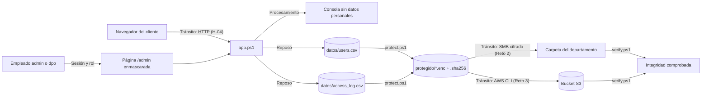

# Flujo de datos de Data Hunt

| Estado | Dónde | Control |
|---|---|---|
| Tránsito | Navegador → app | [HTTPS o riesgo aceptado] |
| Tránsito | Servidor → carpeta del departamento | SMB cifrado |
| Tránsito | Servidor → S3 | AWS CLI (TLS) |
| Reposo | `datos/`, `protegido/`, S3 | Permisos, ChaCha20-Poly1305, SHA-256 |
| Procesamiento | Consola, `/admin` | Consola sin datos, sesión, rol, enmascaramiento, bitácora |